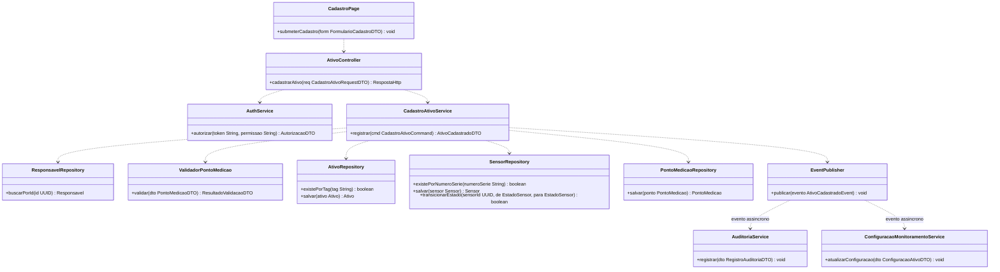
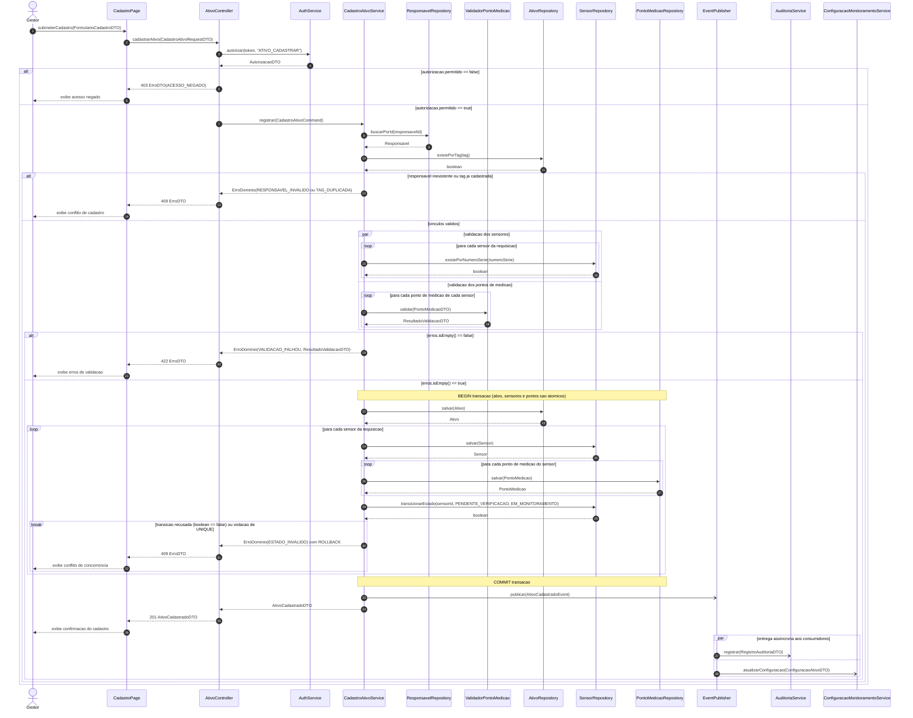
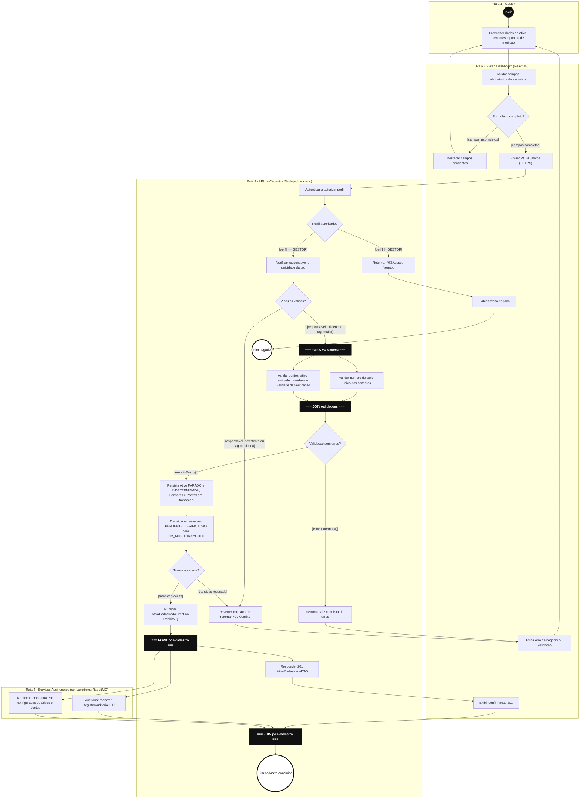
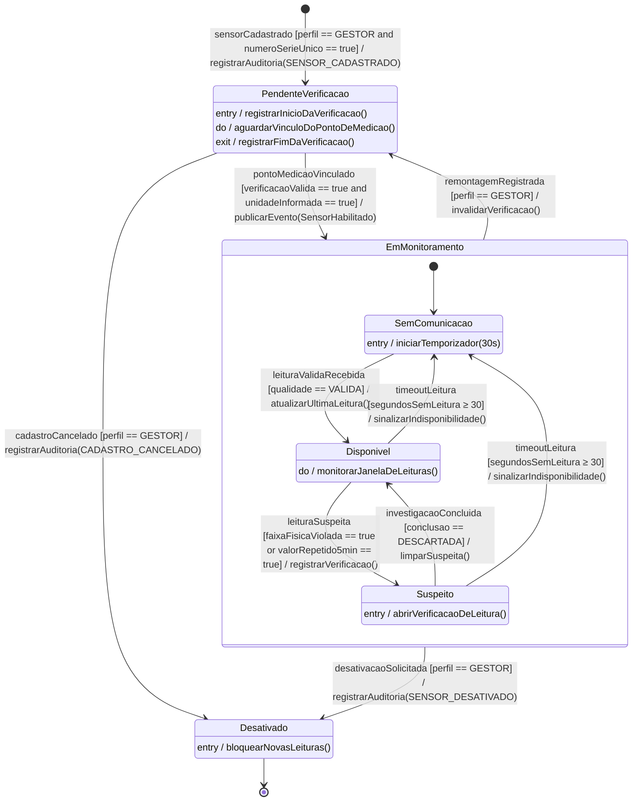
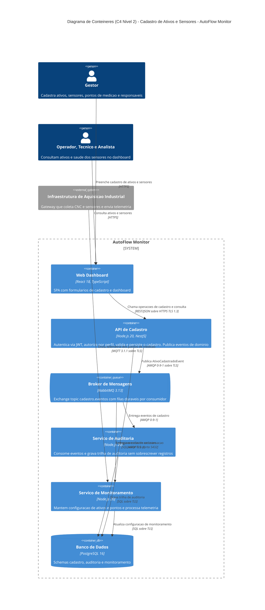

# APS 3 — Dossiê de Arquitetura Viva e Modelagem Comportamental as-Code

| | |
|---|---|
| **Aluno** | Nome Sobrenome *(substituir)* |
| **Unidade Curricular** | Modelagem de Software — Engenharia de Software, 4º período (UniSenai) |
| **Projeto** | AutoFlow Monitor — Monitoramento IoT na Usinagem de Componentes Automotivos |
| **Funcionalidade crítica** | **Cadastro de ativos e sensores** (RF02 / UC04) |
| **Ator principal** | Gestor |

## 1. A funcionalidade

O Gestor cadastra um **ativo monitorado** (CNC ou bancada, com responsável e criticidade), seus **sensores** e os **pontos de medição** que ligam cada sensor ao ativo, com posição, grandeza, unidade e validade da verificação. Sem esse cadastro, a telemetria não tem a quem ser associada, e por isso a funcionalidade é crítica para todo o restante do monitoramento (RF04, RN01, RN02).

**Pré-condição:** Gestor autenticado com permissão `ATIVO_CADASTRAR` (RF01, RNF02).

**Regras aplicadas**

- **RF02:** não pode existir ponto de medição sem vínculo com ativo e unidade.
- **Estados independentes** (escopo 2.1): o ativo nasce com estado operacional `PARADO` e condição `INDETERMINADA`; o estado do sensor é separado de ambos.
- **Remontagem exige nova checagem:** o sensor volta a `PendenteVerificacao`.
- **RNF03:** toda criação gera trilha de auditoria, sem sobrescrever registros.
- **RNF05:** os consumidores dos eventos são idempotentes.

**Pós-condição (sucesso):** ativo, sensores e pontos persistidos em uma única transação. Os sensores ficam em `EM_MONITORAMENTO`, no subestado `SemComunicacao` até a primeira leitura válida. `AtivoCadastradoEvent` é publicado e consumido pela Auditoria e pelo Monitoramento.

## 2. Contrato de interfaces e DTOs

Regra de consistência do Artefato 1: toda mensagem enviada a uma linha de vida deve existir como operação pública na classe ou interface correspondente. O diagrama a seguir é esse contrato.

| DTO | Campos principais |
|---|---|
| `CadastroAtivoRequestDTO` | `tag`, `nome`, `tipo` (CNC \| BANCADA), `criticidade`, `responsavelId`, `sensores: SensorDTO[]` |
| `SensorDTO` | `numeroSerie`, `modelo`, `pontosMedicao: PontoMedicaoDTO[]` |
| `PontoMedicaoDTO` | `posicao`, `grandeza` (TEMPERATURA \| VIBRACAO_RMS), `unidade`, `verificacaoValidaAte` |
| `AutorizacaoDTO` | `permitido`, `perfil`, `usuarioId` |
| `ResultadoValidacaoDTO` | `valido`, `erros: String[]` |
| `AtivoCadastradoDTO` | `ativoId`, `estadoOperacional` (PARADO), `condicao` (INDETERMINADA), `sensores: [{sensorId, estado, pontoIds}]`, `criadoEm` |
| `ErroDTO` | `codigo`, `mensagem`, `detalhes[]` |
| `AtivoCadastradoEvent` | `eventId`, `ativoId`, `usuarioId`, `ocorridoEm`, `sensores[]` |

## 3. Artefato 1 — Diagrama de Sequência

`->>` indica chamada síncrona bloqueante e `-)` indica mensagem assíncrona. O diagrama usa os fragmentos `alt/else` (autorização, vínculos, validação), `par` (validação concorrente e entrega aos consumidores), `loop` (sensores e pontos) e `break` (rollback por conflito).

## 4. Artefato 2 — Diagrama de Atividades com Raias

Quatro raias (Gestor, Web Dashboard, API de Cadastro e Serviços Assíncronos). Há quatro decisões com guardas mutuamente exclusivas e dois pares Fork/Join: validação de sensores e pontos em paralelo, e resposta ao Gestor em paralelo com Auditoria e Monitoramento. O Mermaid não tem nó de barra nativo, então as barras são nós escuros rotulados FORK e JOIN.

## 5. Artefato 3 — Máquina de Estados (entidade `Sensor`)

O ciclo de vida cadastral (`PendenteVerificacao`, `EmMonitoramento`, `Desativado`) engloba os três estados de saúde do sensor definidos no escopo (`Disponivel`, `Suspeito`, `SemComunicacao`) como subestados. `Desativado` é o estado terminal: não há reativação, e um novo cadastro preserva o histórico anterior.

**Proteção contra estados inválidos:** eventos não mapeados no estado atual são rejeitados e não alteram nada. Por exemplo, `leituraValidaRecebida` em `PendenteVerificacao` é rejeitada. No banco, a transição é um *compare-and-set* (`UPDATE ... WHERE estado = :de`), o que impede corrida entre requisições concorrentes.

## 6. Artefato 4 — C4 Nível 2 (Contêineres)

Escrito em Mermaid C4. As tecnologias e os protocolos estão explícitos nos conectores.

## 7. Artefato 5 — ADR 0001

[`docs/architecture/adr-0001.md`](docs/architecture/adr-0001.md): propagação assíncrona do cadastro por eventos de domínio (RabbitMQ). A decisão é *Aprovada*, com alternativas, consequências e riscos aceitos documentados.

## 8. Matriz de consistência entre os modelos

| Passo na Sequência | Nó nas Atividades | Transição na Máquina de Estados | Regra |
|---|---|---|---|
| `autorizar(token, "ATIVO_CADASTRAR")` | C1, D2 | guarda `perfil == GESTOR` | RF01, RNF02 |
| `buscarPorId`, `existePorTag` | C3, D3 | — | RF02 |
| `existePorNumeroSerie` | C5 (ramo do Fork 1) | guarda `numeroSerieUnico == true` | identificação única |
| `validar(PontoMedicaoDTO)` | C6 (ramo do Fork 1) | guarda `verificacaoValida and unidadeInformada` | RF02 |
| `salvar(Ativo/Sensor/PontoMedicao)` | C8 | `[*] → PendenteVerificacao` | RNF03 |
| `transicionarEstado(PENDENTE → EM_MONITORAMENTO)` | C9, D5 | `pontoMedicaoVinculado` | proteção do estado |
| `break` com rollback | C4 (409) | transição recusada, sem mudança de estado | consistência |
| `publicar(AtivoCadastradoEvent)` | C10, Fork 2 | ação `publicarEvento(SensorHabilitado)` | ADR 0001 |
| `registrar(RegistroAuditoriaDTO)` | E1 | ação `registrarAuditoria()` | RNF03 |
| `atualizarConfiguracao(...)` | E2 | — | RN01, RN02 |

## 9. Como renderizar e validar

- Os blocos `mermaid` acima renderizam direto no GitHub.
- Para validar localmente: `npx @mermaid-js/mermaid-cli -i docs/diagrams/sequencia.mmd -o sequencia.svg` (repita para cada `.mmd`).
- Os cinco arquivos-fonte ficam em `docs/`. Faça commits incrementais por artefato para evidenciar a evolução (política de auditoria da APS).
